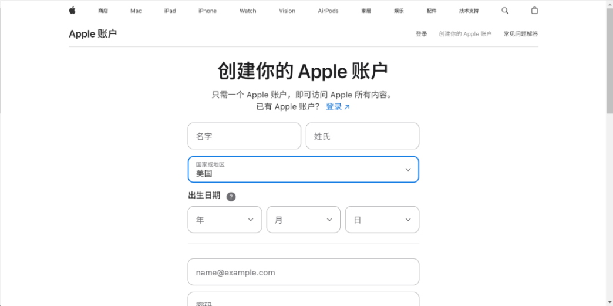
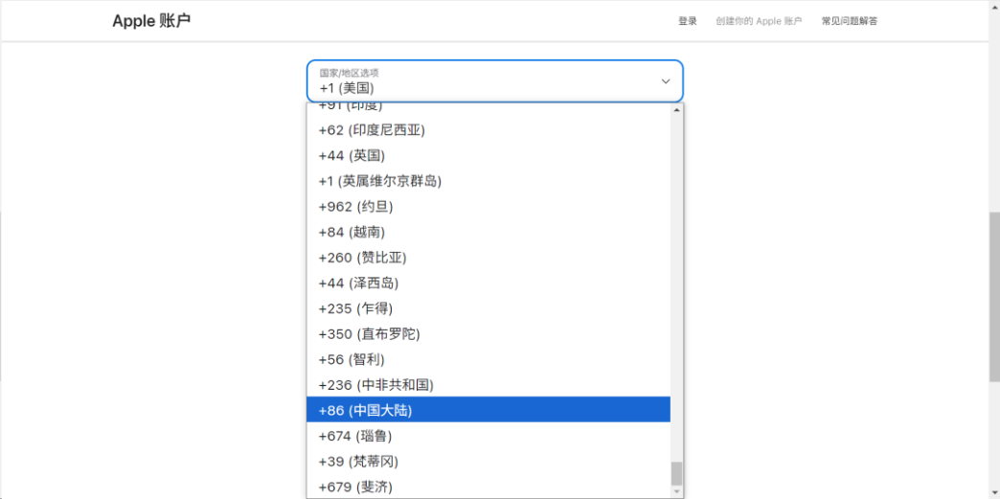
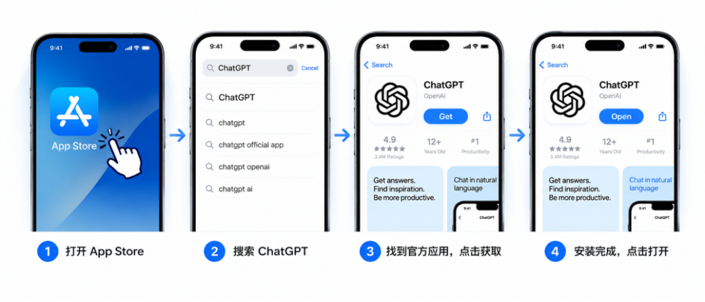

# 美区 Apple 账户注册指南

## 开始前准备

- **邮箱**。准备一个可以长期使用、尚未注册过 Apple 账户的邮箱。这个邮箱将用作登录账号。
- **手机号**。准备一个自己能长期使用的真实号码，确保它可以接收短信或语音验证码。

## 在网页上注册

### 1. 打开 Apple 账户网站

访问 [account.apple.com](https://account.apple.com/)，选择「创建你的 Apple 账户」。

### 2. 填写基础资料

填写真实姓名和出生日期，在「国家或地区」中选择「美国」。输入准备好的邮箱，并设置一个强密码。

### 3. 填写长期可用的手机号

接下来填写接收验证码的手机号。这里的国家代码按**手机号的归属地**选择。使用中国大陆手机号时，选择「+86（中国大陆）」，再输入手机号码。

### 4. 完成邮箱和手机号验证

先查看邮箱，输入 Apple 发来的验证码，再按页面提示完成手机号验证。两项验证完成后，就可以用刚注册的账户登录 Apple 服务。

### 5. 登录 App Store 并下载 ChatGPT

在 iPhone 上打开 App Store，点右上角的头像，用刚注册的邮箱和密码登录。搜索「ChatGPT」，认准开发者 **OpenAI**，点「获取」。安装完成后，点「打开」。

本篇到安装应用为止。订阅 ChatGPT 时如何付款，留到下一篇介绍。

## 常见问题

### 需要美国手机号吗？

按注册页面提供的国家代码填写自己能长期接收验证码的号码。参考图中，账户地区选的是「美国」，手机号一栏用的是「+86（中国大陆）」。

### 提示 “Your account cannot be created at this time” 怎么办？

先确认网络可以正常访问 Apple 网站，再查看 [Apple 系统状态](https://www.apple.com/support/systemstatus/)。如果服务暂时异常，稍后再试。如果仍然提示创建失败，可以更新设备系统或 Apple 应用，或改用另一种官方方式创建账户，例如从网页切换到 Apple 设备上注册。
